# EveryInfra SEO Skills

<p align="center">
  <picture>
    <source media="(prefers-color-scheme: dark)" srcset="assets/hero-dark.svg">
    <source media="(prefers-color-scheme: light)" srcset="assets/hero-light.svg">
    
  </picture>
</p>

<p align="center">
  
  
  
  
</p>

<p align="center"><b>简体中文</b> · <a href="README.en.md">English</a> · <a href="README.es.md">Español</a></p>

**免费下载，用你自己的 AI 工具和模型。**

**一行安装**（自动识别本机已装的 Claude Code、Codex、Cursor 等宿主）：

```bash
curl -fsSL https://raw.githubusercontent.com/everyinfra/seo-skills/main/install.sh | bash
```

> 由 [EveryInfra（万有引擎）](https://everyinfra.com/) 维护。需要实时数据时，可以接 EveryInfra 的[全网搜索 API](https://everyinfra.com/products/search)（17 种检索工具）和 [90 个平台的数据接口](https://everyinfra.com/market)（小红书、抖音、淘宝等）；本 Skill 不依赖它们。

EveryInfra SEO Skills 的版本为 `0.36.0`，采用 Apache-2.0 许可协议。仓库里是一个 SEO / GEO 工作台 Skill：`seo-suite`。它是一组工作说明、参考资料和输出模板，本身不调用模型，不捆绑模型提供商，也没有 API Key 或运行时依赖。模型和模型额度来自你自己的 AI 工具。

**独有差异化：全球 SEO/GEO 一把做。** 面向全球做产品的团队不想装十几个单市场工具——本套件把 **18 个语言市场**放进同一个工作台，逐市场分开评分：中文（实测引用经济学）、英文、俄语区（Yandex/Alice）、韩语区（Naver/AI Briefing）、日语区（Yahoo! Japan+Bing+AIO）、西语（es-419 拉美分裂）、葡语（巴西=ChatGPT 最强市场）、阿拉伯语（RTL+MSA/方言）、法语（Bill 96）、德语（DACH Sie/du）、印尼语（baku/gaul）、印地语（Hinglish 三种书写）、意大利语（it-CH 独立 locale）、土耳其语（第二个 Yandex 市场，~26%）、越南语（有调/无调+Coc Cốc）、泰语（无空格分词）、波兰语（变音符规范化）、荷兰语（nl-NL/nl-BE 弗拉芒）。**全球能力不做成独立模块，而是融入五类能力文件的每一类**——主干是 `overview/multilingual-workflow.md`（市场总表、逐市场工具栈、语言规范、合规速查）。

<details>
<summary><b>版本演进：0.5 → 0.35</b></summary>

**0.5 系列:市场 × 能力双维度架构 + 18 市场逐一深挖。** 每个任务先定市场再进能力路由;`multilingual-workflow.md` 内含**十八市场独到方法索引**(每市场"只有在这里才需要做"的做法,如中文的搜一搜 Peoplerank/小红书 CES 分、韩国的 `nosourceinfo` 官方 AI 引用退出、巴西的 Reclame Aqui 22.3% 被引、日本的「AI 臭」密度检测、泰国的 `Intl.Segmenter` 分词定论)与**跨区融合 23 条原则**(断言半衰期、口径冲突并记、主权助手模式、语域双轨模板等)。

**0.9 深挖轮:本地社区层。** 17 个市场逐一用本地语言挖了"圈内才知道的事"——主干新增「本地社区与信息源索引」(每市场信息源/圈内共识/国际圈误解纠偏),如俄罗斯的 76 条商业因子清单与区域 lr 码、韩国的发帖时刻表与保存市场、日本的内链数值惯例与 MEO 十倍价差、德语区的 Abmahnung 法律战、土耳其的 tanıtım yazısı 链接市场、泰国的"หลังบ้าน"灰链红线、法国 AIO 晚德一年=红利窗口;**七大 marketplace 站内 SEO 分叉**、融合原则扩至 27 条。

**0.16–0.23 系列:实装化+全覆盖。** 规则变代码——**35 个 stdlib 零依赖脚本**(当时;单页审计/AI 爬虫姿势/CJK 文本度量/GSC 导出挖掘/sitemap 六坏桶/hreflang 簇矩阵/引用采样面板 Wilson CI/DiD 归因/网格排名 ARP·ATRP·SoLV…)+ `markets.json` 18 市场规则数据层(130 项市场特检)+ `market_lint.py` 24 条动态自动检查+**32 个 golden 测试**(self_check 每次全跑)。**8 个新专项模块**:agent 协议速查(14 卡)/审计规则目录(SEOmator 373 规则)/Naver 官方文档蒸馏/head 元素完整参考/SERP 数据模型/证据银行/域名策略(过期域滥用红线·AI 记品牌不记 URL)/站群光谱(白帽→泛站群·六目标灰帽→白帽等效)/pSEO 九章作战手册(四案例 sitemap 实测)/**站型打法手册(8 卡)**/CWV 完整手册/移动 SEO(2024-07 起只抓 smartphone UA)/惩罚恢复(11 类手动动作)/重定向 canonical 六场景/UGC+站内搜索。**18 个语区门户页**(`references/markets/` 每语区一份,2026-10 母语定向研究)。

**0.24–0.30 系列:持续监控与自更新闭环。** 从一次性审计升级为长期守护——`monitor.py` 持续监控守护(日检四问/周趋势/SQLite 快照/四级告警+冷却与防疲劳,SSRF/密钥守卫)+`notify.py` 四渠道分级通知+GitHub Actions 部署模板;`market_lint.py` 升至 64 条检查;**`intel_check.py`+自更新协议**(18 源信源监控,变更→受影响文件映射→P0-P3 分级更新);golden 测试增至 **71 个**;脚本总数增至 **38 个**。

</details>

## 为什么是现在 / Why now

> 数字来自公开研究、厂商研究或预测,口径写在括号里;来源与核对结论登记于 `skills/seo-suite/references/content/geo-platform-differences.md` 第五节(核对 2026-10-21)。相关不等于因果。

| 指标 | 数值(口径) |
|---|---|
| GEO 服务市场 | 2024 年 8.86 亿美元 → 2031 年 73.18 亿(Valuates 估算,各家估算差异大) |
| AI 引荐会话增长 | +527%(Previsible,19 个 GA4 站点,2025-01~05 对比 2024 同期);166 站更新值:2024-11~2026-05 月会话 9.9 倍 |
| AI 流量转化价值 vs 自然搜索 | 4.4 倍(Semrush 2025-06,500 多个 SEO 话题,厂商研究) |
| 品牌的自然搜索流量(到 2028) | −50% 或更多(Gartner 2023-12 预测,不是实测) |
| 全网品牌提及 vs 外链数,与 AIO 品牌提及次数的相关 | Spearman 0.664 对 0.218,约 3 倍(Ahrefs 7.5 万品牌) |
| GEO 论文三种改写方法的可见性提升 | +30–40%(KDD 2024,gpt-3.5-turbo、固定前 5 条结果) |

**全球市场(核对 2026-10-21;未核的已删):**

| 指标 | 数值 | 来源 |
|---|---|---|
| Yandex 在俄搜索份额 | 70.33%(2026-09) | StatCounter |
| Naver 在韩份额 | 62.6%(本土面板,2026-04);StatCounter 2026-09 为 Google 47.97%、Naver 43.06% | InternetTrend / StatCounter |
| 韩国 AI 브리핑 引用来源 | 几乎全部为 Naver 自有生态 | Andgentic(厂商博客) |
| 日本 AIO 出现率 | 76.9% 日语查询(1,459 查询实测) | Itera(行业) |
| 日本 AI 搜索使用率 | 21.3%(2025-05)→ 37.0%(2026-02);含 AI Mode 52.3%(2026-08) | CyberAgent |
| 巴西 ChatGPT App | 约 5,400 万月活(2025-07) | Atlantico(经转述) |
| 西语查询的 AI 引用语言绑定 | 83–84% 引西语源(只是 Google AIO 和 Copilot;Grok 55% 以上) | Temso(行业研究) |
| Yandex 在土耳其份额 | 25.19%(2026-09)——俄语区之外第二个 Yandex 市场 | StatCounter |
| 印度 ChatGPT 采用 | 约 1 亿周活 | Sam Altman(TechCrunch 2026-02 转述) |

## 它是什么

`seo-suite` 是一个统一的 SEO 入口：先做统一 intake（站点、市场、目标、已知问题、可用数据），再把任务路由到 overview、research、content、technical、monitoring 五类能力，最后按固定结构给出结论、优先级和验证方法。

它强调证据：不报告页面上不存在的信号，不承诺排名、流量或 AI 引用的提升。GEO（AI 搜索可见度）相关建议以 `references/content/geo-evidence.md` 的证据约束为准。

## 能做哪些 SEO 任务

| 能力集合 | 典型任务 |
|---|---|
| overview | 整站 SEO 诊断、路线图与优先级排序、不知道先做什么时的分诊、目标市场 intake 闸门 |
| research | 关键词研究与搜索意图（各市场工具链+persona×意图 SXO 层）、SERP 分析（含各市场 AIO 覆盖与 SERP 占位层）、内容缺口、竞品、目录提交引擎、外链画像 |
| content | SEO 内容 brief 与写作、标题与 meta 描述、GEO / AI 搜索可见度优化（含区域 AI 平台）、中文 AI 搜索、**视频 SEO/GEO**（YouTube 被引机制/人工字幕层）、**电商 GEO 五级阶梯+七大 marketplace 站内 SEO**（ML/Trendyol/Allegro/bol/Shopee）、内容质量、旧内容刷新 |
| technical | 技术 SEO 与单页审计、robots.txt 与 AI 爬虫政策（含区域爬虫/MistralAI/Bytespider）、hreflang 国际化、结构化数据（含富结果状态速查）、内链与架构、实体、Programmatic SEO、Core Web Vitals、**JS 渲染与 SPA SEO**（五引擎渲染差异）、**Agent-Readiness 协议层**（ARD/WebMCP）、**服务器日志分析**（AI 到访测量/a11y 三分法）、归因埋点 |
| monitoring | 排名追踪、外链（含各市场本地目录与 Google 链接垃圾政策边界；买链价格表已于 2026-10 删除）、品牌提及（四级引用阶梯+各市场监控通道）、**算法更新归因**（官方时间线/数据文件）、SEO 漂移监控、指标与报告 |
| **专项模块** | 域名策略（选域/过期域尽调/迁移 checklist/AI 引用继承）、站群光谱与白帽替代、pSEO 九章手册、站型打法（SaaS/电商/媒体/本地/文档/工具/Marketplace/YMYL）、CWV 四指标、移动 SEO、惩罚恢复、重定向与 canonical、UGC 与站内搜索 |
| **可执行层** | 87 个 stdlib 脚本+markets.json 数据层+1,787 个测试(2026-10-21)——AI 用 skill 时直接跑脚本拿事实再按能力文件解读 |

**全球能力不是独立模块,而是融在每个能力集合里**：`overview/multilingual-workflow.md` 是全球主干（18 个市场的引擎格局、逐市场工具栈、语言规范、合规速查），各能力文件按需携带对应区域知识。

## 你需要自备什么

- 一个支持 Skill 的 AI 工具，以及你自己配置的模型。
- 需要数据的任务，使用你自己的数据源：Google Search Console、GA4、Bing Webmaster Tools 的导出，或你自己账号下的排名追踪、外链、爬虫工具的导出。
- 可选的外部 API（例如 PageSpeed Insights API、Knowledge Graph Search API）需要你自己的 Key。本仓库不包含、也不提供任何 Key。
- 外联邮件、发布内容等对外动作，Skill 只负责起草，由你本人确认后执行。

## 60 秒体验

零依赖、零 API Key——全部脚本只用 Python 标准库。克隆或下载 ZIP 后无需安装,一条命令链对 `example.com` 跑通最小闭环:**体检 → 分层健康分 → 修复建议**:

```bash
cd seo-skills/skills/seo-suite
python3 scripts/site_audit.py https://example.com --json > /tmp/audit.json
python3 scripts/health_score.py --input /tmp/audit.json
python3 scripts/fix_plan.py --audit /tmp/audit.json --estimate
```

预期输出一行示意(实测):`主分 0.0 → Weak(example.com 缺 meta description/H1,命中属实) · Lumar 六类合成分 94.3 · AI Search Health 70/100 · fix_plan dry-run 预览逐类修复物+收益预估(默认不写盘)`。

## 安装

**一行安装（推荐，自动检测已装的宿主并逐一适配）**：

```bash
curl -fsSL https://raw.githubusercontent.com/everyinfra/seo-skills/main/install.sh | bash
```

真源装到 `~/.agents/skills/seo-suite`（Codex/Cursor/Gemini CLI/Goose/Amp/Copilot/ZCode 直读），并向检测到的宿主（Claude Code/Windsurf/Kiro 等）建 symlink；`--all` 装全部、`--agent` 指定、`--uninstall` 卸载。各宿主的调用与验证方式见 [HOSTS.md](HOSTS.md)。

手动方式: 在 GitHub 仓库页面用 **Code → Download ZIP** 下载并解压，或者克隆：

```bash
git clone https://github.com/everyinfra/seo-skills.git
```

下面的命令假设仓库目录名是 `seo-skills`；用 ZIP 解压时目录名可能是 `seo-skills-main`，替换成实际目录即可。

### Claude Code / ZCode：Plugin 一条命令

本仓库自带 Plugin/Marketplace 清单（`.claude-plugin/` 与 `.zcode-plugin/`），支持一条命令安装与更新：

```bash
claude plugin marketplace add everyinfra/seo-skills
claude plugin install seo-suite@everyinfra-seo-skills
# 更新：claude plugin update seo-suite@everyinfra-seo-skills
```

（旧版本 Claude Code 用 `/plugin marketplace add everyinfra/seo-skills` → `/plugin install seo-suite@everyinfra-seo-skills`。）形态选择的完整分析见 [PACKAGING.md](PACKAGING.md)。

### Codex（CLI / IDE）

把 `skills/seo-suite` 整个文件夹复制到 `~/.agents/skills/`：

```bash
mkdir -p ~/.agents/skills
cp -R seo-skills/skills/seo-suite ~/.agents/skills/
```

在 Codex 中用 `$seo-suite` 调用，或直接描述 SEO 任务，由 Codex 按 Skill 描述选用。没有识别到时，重启 Codex 再试。

### Claude Code（手动方式）

把 `skills/seo-suite` 整个文件夹复制到 `~/.claude/skills/`（对所有项目生效），或项目内的 `.claude/skills/`（只对该项目生效）：

```bash
mkdir -p ~/.claude/skills
cp -R seo-skills/skills/seo-suite ~/.claude/skills/
```

在 Claude Code 中用 `/seo-suite` 调用，或直接描述 SEO 任务，由 Claude Code 按 Skill 描述选用。

其他兼容 Skill 的工具（Cursor/VS Code Copilot/Gemini CLI/Windsurf/Goose/Amp/Kiro 等）的目录与调用对照见 [HOSTS.md](HOSTS.md)。参考：[Build skills — Codex](https://developers.openai.com/codex/build-skills) · [Extend Claude with skills](https://code.claude.com/docs/en/skills)

## 目录结构

```text
seo-skills/
├── README.md              中文说明
├── README.en.md           English README
├── README.es.md           README en español
├── LICENSE                Apache-2.0 全文
├── NOTICE                 署名与第三方资料说明
├── CHANGELOG.md           版本记录
├── manifest.json          包信息
└── skills/
    └── seo-suite/
        ├── SKILL.md       入口：intake、能力路由表、输出结构(脚本说明在 references/overview/script-catalog.md)
        ├── scripts/       59 个可执行脚本(审计/多语言/GSC/归因/网格排名/监控/信源检查…)+markets.json
        ├── tests/         1,787 个测试(self_check 全跑)
        ├── examples/      金标准样例输出
        ├── references/
        │   ├── overview/     能力地图、路由规则、intake 清单(含目标市场闸门)、多语言工作流(全球主干:市场总表/工具栈/规范/合规)
        │   ├── research/     搜索意图(含各市场关键词工具链)、SERP、内容缺口、竞品、专题集群、内容策略、外链
        │   ├── content/      GEO 证据约束、标题与 meta、内容结构与写法、中文 AI 搜索指南、AI 平台差异(含区域 AI 平台)、内容刷新
        │   ├── technical/    robots 与 AI 爬虫(含 Yandex/Naver/Bing 日)、hreflang(含 es-419/RTL)、Schema、内链与架构、实体、性能、埋点
        │   ├── monitoring/   排名追踪、外链、指标、报告、告警、漂移、惩罚恢复
        │   └── markets/      18 个语区门户页(zh/en/ru/ko/ja/es/pt/ar/fr/de/id/hi/it/tr/vi/th/pl/nl)
        └── templates/
            ├── research/     研究类输出模板
            ├── audit/        审计类输出模板
            └── monitor/      监控类输出模板
```

## 第三方资料

`references/` 中的资料由 EveryInfra 自行编写。部分主题的组织思路参考了开源项目和公开文档；本仓库不包含这些资料的原文，只提供我们自己的要点摘要和原文链接，每个文件末尾的「来源」一节列出对应链接。详见 [NOTICE](NOTICE)。

## 反馈

问题和建议请提交到 [GitHub Issues](https://github.com/everyinfra/seo-skills/issues)。请勿在 Issue 中粘贴 API Key、凭据、客户数据或其他机密信息。

## 许可证

Apache-2.0，见 [LICENSE](LICENSE)。
