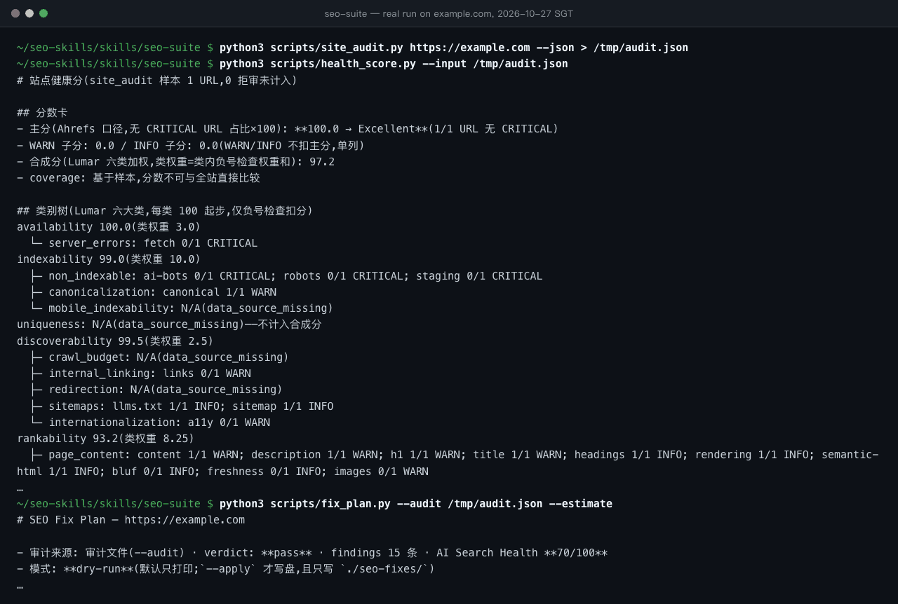
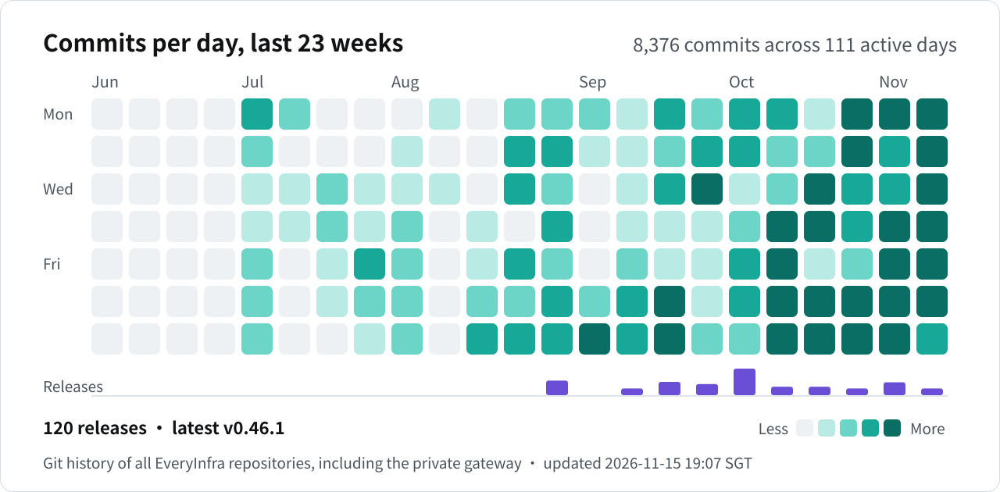

# EveryInfra SEO Skills

<!-- rq223-banner -->
<p align="center"></p>

<p align="center">
  <picture>
    <source media="(prefers-color-scheme: dark)" srcset="assets/hero-dark.svg">
    <source media="(prefers-color-scheme: light)" srcset="assets/hero-light.svg">
    
  </picture>
</p>

<p align="center">
  
  
  
  
</p>

<p align="center"><a href="README.md">English</a> · <a href="README.zh-CN.md">简体中文</a> · <a href="README.es.md">Español</a> · <b>Türkçe</b></p>

**İndirmesi ücretsiz. Kendi yapay zekâ aracınızı ve modelinizi kullanın.**

**Tek satırda kurun** (makinenizdeki  Claude Code,  Codex,  Cursor ve diğer ajan araçlarını otomatik algılar):

```bash
curl -fsSL https://raw.githubusercontent.com/everyinfra/seo-skills/main/install.sh | bash
```

> [EveryInfra](https://everyinfra.com/en) tarafından sürdürülmektedir. Bir görev canlı veri gerektirdiğinde EveryInfra bir [web arama API'si](https://everyinfra.com/en/products/search) (17 araç) ve [90 platform için veri API'leri](https://everyinfra.com/en/market) sunar; ancak bu Beceri bunlara bağımlı değildir.

EveryInfra SEO Skills sürüm `0.48.2`, Apache-2.0 lisansı altındadır. Tek bir SEO / GEO çalışma tezgâhı Becerisi: `seo-suite` — talimatlar, referans notları ve çıktı şablonları. Model çağrısı yok, dahili sağlayıcı yok, API anahtarı yok, çalışma zamanı bağımlılığı yok. Model ve kotası halihazırda kullandığınız yapay zekâ aracına aittir.

**Fark yaratan nokta: tek geçişte küresel SEO/GEO.** Dünya çapında ürün yayımlayan ekipler bir düzine tek pazarlı araç istemez. Bu paket **18 dil pazarını** tek çalışma tezgâhında pazar pazar puanlar: Çince, İngilizce, Rusça (Yandex/Alice), Korece ( Naver/AI Briefing), Japonca (Yahoo! Japan + Bing + AI Overviews), İspanyolca (es-419 LatAm ayrımları), Portekizce (Brezilya =  ChatGPT'nin en güçlü pazarı), Arapça (RTL + MSA vs lehçeler), Fransızca (Bill 96), Almanca (DACH Sie/du), Endonezce (baku vs gaul), Hintçe (Hinglish üç alfabe gerçeği), İtalyanca (kendi yerel ayarı olarak it-CH), Türkçe (ikinci bir Yandex pazarı, ~%26), Vietnamca (aksan varyantları + Coc Cốc), Tayca (boşluksuz yazı segmentasyonu), Lehçe (aksan kanonikleştirme), Felemenkçe (Flaman nl-BE). Küresel yetenek ayrı bir modül değil, **her yetenek setinin içine işlenmiştir** — omurgası `overview/multilingual-workflow.md` dosyasıdır.

## Yalnızca bu paketin sundukları

- **18 pazar portalı.** `references/markets/` her dil pazarı için bir portal barındırır (zh, en, ru, ko, ja, es, pt, ar, fr, de, id, hi, it, tr, vi, th, pl, nl) ve her biri Ekim 2026'da anadil araştırmasıyla yazılmıştır: arama motoru görünümü, yerel araç yığını, topluluk içgörüleri, uyumluluk notları.
- **Vikipedi düzeyinde kanıt disiplini.** İddialar kaynak türleri ve geçerlilik yarı ömürleri taşır; beceri sayfada olmayan bir sinyali asla raporlamaz ve sıralama, trafik veya yapay zekâ atıf artışı vadetmez. GEO tavsiyeleri bir kanıt kısıt dosyasıyla (`references/content/geo-evidence.md`) sınırlandırılmıştır; aşağıdaki "Neden şimdi" bölümündeki her sayının kayıtlı bir kaynağı vardır.
- **Kendini güncelleyen istihbarat döngüsü.** `intel_check.py` 18 veri kaynağını (motor blogları, robots ve yapay zekâ tarayıcı politikaları, ajan spesifikasyonları, pazar payı izleyicileri) izler, doğrulamak için özet değişikliklerini yeniden çeker, her gerçek değişikliği etkilenen referans dosyalarıyla eşler ve yazılı bir öz-güncelleme protokolü altında gereken güncellemeyi P0–P3 olarak derecelendirir — becerinin verileri pazardan daha yavaş eskiyecek şekilde tasarlanmıştır.
- **Tek seferlik denetimler değil, bir izleme servisi.** `monitor.py` günlük dört soruluk kontroller ve haftalık sapma takibi çalıştırır, SQLite anlık görüntüleri tutar ve bekleme süresi ile yorgunluk önleme kurallarıyla dört kademeli uyarılar (artı SSRF ve gizli anahtar korumaları) üretir; `notify.py` bildirimleri ciddiyete göre dört kanala dağıtır; GitHub Actions dağıtım şablonları dahildir.
- **SEO için CI kapıları.** Depo kökündeki birleşik aksiyon (`action.yml`) her pull request'te denetim yapar, `min-score` eşiğinin altında derlemeyi başarısız kılar ve `ci_format.py` ile SARIF / JUnit / GitHub PR notları üretir — SEO gerilemeleri tıpkı test hataları gibi ortaya çıkar.
- **Bir işlem hattı orkestratörü.** `project.py` her siteye bir çalışma alanı ve beş aşamalı bir durum makinesi (denetle → önceliklendir → düzelt → doğrula → izle) verir: `run triage` tek komutta tarama → denetim → sağlık puanı → öncelikler zincirini çalıştırır, `next` bir sonraki yapıştırılacak tam komutu yazdırır, `status` puan eğilimini gösterir. Diğer betikleri alt süreç olarak orkestre eder, yeniden uygulamaz.

## Buraya nasıl geldi (0.5 → 0.34)

Özetle tüm gelişim: 0.5 serisi **pazar × yetenek çift boyutlu mimarisini** tanıttı — her görev önce pazarını seçer, sonra yeteneğe göre yönlenir — 18 pazarın tamamı için derin incelemeler ve 23 bölgeler arası birleşim ilkesiyle; 0.9 İngilizce dışındaki 17 pazarı kendi dillerinde yeniden taradı (yerel topluluk ve bilgi kaynağı dizini, 27'ye çıkan birleşim ilkeleri); 0.16–0.23 kuralları koda dönüştürdü — yalnızca stdlib betikleri, dinamik `market_lint.py` kontrolleriyle `markets.json` 18 pazar kural katmanı, altın testler, uzman modüller ve 18 pazar portalı; 0.24–0.30 izleme servisini ve öz-güncelleme döngüsünü ekledi; 0.31'den bu yana çalıştırılabilir katman **91 betik ve 1.871 teste** ulaştı (`self_check` her geçişte hepsini çalıştırır), ayrıca CI kapıları ve `project.py` orkestratörü eklendi. Tam geçmiş: [CHANGELOG.md](CHANGELOG.md).

## Neden şimdi?

> Rakamlar kamuya açık çalışmalardan, satıcı araştırmalarından veya tahminlerden alınmıştır; kapsam parantez içindedir. Kaynaklar ve kontrol sonuçları `skills/seo-suite/references/content/geo-platform-differences.md` bölüm 5'te kayıtlıdır (kontrol tarihi 2026-10-21). Korelasyon nedensellik değildir.

| Metrik | Değer (kapsam) |
|---|---|
| GEO hizmetleri pazarı | $886M (2024) → 2031'e kadar $7.318B (Valuates tahmini; tahminler geniş aralıkta değişir) |
| Yapay zekâ yönlendirmeli oturumlar | +%527 (Previsible, 19 GA4 sitesi, Oca–May 2025 vs 2024); güncelleme: 166 site, aylık oturumlar Kas 2024'ten May 2026'ya 9,9 kat |
| Dönüşüm oranına göre yapay zekâ trafiğinin organik trafiğe değeri | 4,4 kat (Semrush, Haz 2025, 500+ SEO konusu, satıcı çalışması) |
| 2028'e kadar markaların organik arama trafiği | −%50 veya daha fazla (Gartner tahmini, Ara 2023; ölçüm değildir) |
| Web marka bahsetmeleri vs geri bağlantılar, AIO marka bahsetmeleriyle korelasyon | Spearman 0,664 vs 0,218, ~3 kat (Ahrefs, 75 bin marka) |
| Üç GEO yeniden yazım yönteminin görünürlük kazanımı | +%30–40 (KDD 2024; gpt-3.5-turbo, sabit ilk 5 sonuç) |

Küresel pazarlar (kontrol tarihi 2026-10-21; doğrulanmamış satırlar kaldırıldı):

| Metrik | Değer | Kaynak |
|---|---|---|
| Rusya aramalarında Yandex payı | %70,33 (Eyl 2026) | StatCounter |
| Kore'de  Naver payı | Yerel panelde %62,6 (Nis 2026); StatCounter Eyl 2026: Google %47,97,  Naver %43,06 | InternetTrend / StatCounter |
| Kore AI Briefing atıf havuzu | neredeyse tamamen Naver mülkleri | Andgentic (satıcı blogu) |
| Japonca sorgularda AI Overviews görünme oranı | %76,9 (1.459 sorgu ölçüldü) | Itera (sektör) |
| Japonya yapay zekâ arama kullanımı | %21,3 (May 2025) → %37,0 (Şub 2026); AI Mode dahil %52,3 (Ağu 2026) | CyberAgent |
| Brezilya  ChatGPT uygulaması | ~54M aylık aktif kullanıcı (Tem 2025) | Atlantico (bildirilen) |
| İspanyolca sorgular için dile bağlı yapay zekâ atıfları | %83–84 İspanyolca kaynaklar (yalnızca Google AIO ve  Copilot; Grok %55+) | Temso (sektör çalışması) |
| Türkiye'de Yandex payı | %25,19 (Eyl 2026) — ikinci bir Yandex pazarı | StatCounter |
| Hindistan  ChatGPT benimsenmesi | ~100M haftalık aktif kullanıcı | Sam Altman (TechCrunch haberi, Şub 2026) |

## Ne yapar?

Tek bir giriş noktası. Bir ürünle ilk kez karşılaştığında katılım (onboarding) sürecini çalıştırır: ürünün kendisini okur (site, fiyatlandırma, belgeler, `llms.txt`, kod deposu), ardından sizinle halka halka doğrular — ürün, hedef kitle ve arama niyeti, rakipler, varlıklar ve kısıtlar, pazarlar ve anahtar kelimeler, strateji ve yol haritası — her halkadan sonra onayınız için durur. Ayrıca ürünü bir yaşam döngüsü aşamasına (fikir, lansman öncesi, yayında, büyüme, olgun, değişim) yerleştirir ve beş alandan en zayıfını (teknik, içerik, bağlantılar ve marka, yapay zekâ görünürlüğü, ekip ve ölçüm) bulur. Son halka aşamaya özel bir plan oluşturur: yalnızca o aşamaya uyan eylemler, her biri için sayfa türü, metrik, ölçüm yöntemi ve hafta, artı Çince ve İngilizce strateji kitabı. Fikir aşamasında gerçek otomatik tamamlama verileriyle talebi doğrular; lansman öncesinde her maddesi sorumlulu bir lansman kontrol listesi çalıştırır. Kendi çalışma biçiminizi de öğretebilirsiniz: "her karşılaştırma sayfasında fiyat tablosu olsun", "Reddit geri bağlantısı önermeyi bırak" veya "bir kontrol ekle: her platform sayfasında MCP çağrı örneği bulunsun" deyin; `teach.py` tam sözlerinizi tarihli olarak site deponuzdaki `seo-ops/playbook/` altına yazar. "X yapma" ifadeleri planın, haftalık gündemin ve erişim betiklerinin doğrudan filtrelediği yapılandırılmış bir red listesine dönüşür; özel bir kontrol önce incelemeniz için 3 sayfada çalıştırılır, yalnızca onayınızdan sonra etkinleştirilir ve kodu değişirse otomatik olarak devre dışı kalır. Yükseltmeler bu klasöre asla dokunmaz ve paylaşılmaya değer bir kontrol, sitenize özel ayrıntılar temizlenerek bu depo için taslak PR'a dönüştürülebilir (sizin yerinize hiçbir şey commit edilmez). Kendi anahtar kelime hacmi, SERP veya geri bağlantı kaynaklarınız `seo-ops/playbook/sources.json` içine gider: önce ücretsiz olanlar kullanılır, ücretli olanlar yalnızca bir komut adlarını verdiğinde çağrılır. Claude Code eklentisi olarak kurulduğunda ayrıca 7 komut (`/seo-suite:start`, `:lifecycle`, `:weekly`, `:launch`, `:site-move`, `:teach`, `:report`), 3 alt ajan (araştırma, denetim, kırmızı takım incelemesi) ve kurallarınızı yükleyen bir oturum başlangıcı kancası ekler; diğer ana bilgisayarlar aynı betikleri çalıştırır ([HOSTS.md](HOSTS.md)). Katılım sonrasında beş yetenek setine — genel bakış / araştırma / içerik / teknik / izleme — yönlenir ve yapılandırılmış çıktı verir: sonuçlar, öncelikler ve her birinin nasıl doğrulanacağı. Hedef pazar ilk zorunlu giriş alanıdır; çünkü hangi arama motorlarının, araç zincirlerinin, eşiklerin ve dil kurallarının geçerli olacağını o belirler.

| Yetenek | Tipik görevler |
|---|---|
| overview (genel bakış) | **Altı halkalı katılım ve ürün profili** (`onboard.py`, `product_scan.py`), **yaşam döngüsü aşaması × olgunluk tanısı** (`lifecycle.py`), **aşamaya özel plan, 90 günlük yol haritası ve iki dilli strateji kitabı** (`plan.py`), fikir aşaması talep ve ad kontrolleri (`demand_check.py`), lansman kontrol listesi (`launch_check.py`), site geneli SEO tanısı, yol haritası ve önceliklendirme, nereden başlayacağınızı bilmediğinizde ön değerlendirme, hedef pazar giriş kapıları |
| research (araştırma) | Anahtar kelime araştırması ve arama niyeti (pazar bazlı araç zincirleri + persona × niyet SXO katmanı), SERP analizi (pazar bazlı AI-Overview kapsamı ve SERP doluluğu dahil), içerik boşlukları, rakipler, dizin gönderim motoru, geri bağlantı profili, **bağlantı istihbaratı** (`link_intel.py`: liste makalesi tohum siteleri, Common Crawl bağlantı grafiği, iş ortağı sayfası takas algılama, takas havuzu, liste makalesi erişim adayları, rakip SERP ayak izi), **klasik hızlı kazanımlar listesi** (33 madde, her biri bir betiğe bağlı) |
| content (içerik) | SEO içerik özetleri ve taslak yazımı, başlıklar ve meta açıklamalar, GEO / yapay zekâ arama görünürlüğü (bölgesel yapay zekâ platformları dahil), Çin yapay zekâ araması, video SEO/GEO ( YouTube atıf mekaniği, manuel altyazı katmanı), beş basamaklı e-ticaret GEO merdiveni + yedi pazar yeri için site içi SEO (MercadoLibre, Trendyol, Allegro, bol,  Shopee dahil), içerik kalitesi, içerik yenileme |
| technical (teknik) | Teknik SEO ve tek sayfa denetimleri, robots.txt ve yapay zekâ tarayıcı politikası (bölgesel tarayıcılar, MistralAI, Bytespider dahil), hreflang uluslararasılaştırma, yapısal veri (zengin sonuç durumu dahil), iç bağlantı ve site mimarisi, varlık sinyalleri, programatik SEO, Core Web Vitals, JS oluşturma ve SPA SEO (beş motorlu oluşturma farkları), Ajan Hazırlığı protokol katmanı (ARD / WebMCP), sunucu günlüğü analizi (yapay zekâ ziyaret ölçümü, erişilebilirlik ön değerlendirmesi), atıf enstrümantasyonu |
| monitoring (izleme) | Sıralama takibi, geri bağlantılar (pazar bazlı yerel dizinler ve Google bağlantı spam politikası sınırı dahil; bağlantı fiyat tabloları Eki 2026'da kaldırıldı), marka bahsetmeleri (dört kademeli atıf merdiveni + pazar bazlı izleme kanalları), algoritma güncellemesi ilişkilendirmesi (resmî zaman çizelgeleri ve veri dosyaları), SEO sapma izleme, metrikler ve raporlama |
| **Uzman modüller** | Alan adı stratejisi (seçim, süresi dolmuş alan adı durum tespiti, taşıma kontrol listesi, yapay zekâ atıf mirası), site ağı spektrumu ve beyaz şapkalı eşdeğerler, 9 aşamalı programatik SEO kılavuzu, site türü kılavuzları (SaaS / e-ticaret / medya / yerel / belgeler / araçlar / pazar yeri / YMYL), CWV dört metriği, mobil SEO, ceza kurtarma, yönlendirmeler ve kanonikleştirme, UGC ve site içi arama |
| **Çalıştırılabilir katman** | 103 stdlib betiği + `markets.json` 18 pazar veri katmanı + 2.088 test (Kas 2026) — yapay zekâ önce gerçekleri almak için betikleri çalıştırır, ardından yetenek dosyalarına göre yorumlar |

Küresel yetenek ayrı bir modül değil, **her yetenek setinin içine işlenmiştir**: [multilingual-workflow.md](skills/seo-suite/references/overview/multilingual-workflow.md) omurgadır (pazar tablosu, pazar bazlı araç yığınları, dil kuralları, uyumluluk) ve her yetenek dosyası kendisiyle ilgili bölgesel bilgiyi taşır.

**Tasarımı gereği çok dilli.** Beceri kullanıcının dilinde yanıt verir ve çok dilli bir sitenin her dil sürümünü ayrı puanlar. Öne çıkan bir örnek: 187.818 atıflık ölçülmüş bir veri seti üzerine kurulu [Çin yapay zekâ arama kılavuzu](skills/seo-suite/references/content/chinese-ai-search-guide.md) — marka siteleri atıfların yalnızca %1,37'sini alırken 28 sıralama sitesi en erken konumların %9,1'ini alır;  Baidu AI / Tencent Yuanbao / Doubao /  Kimi / DeepSeek için motor hendekleri; CJK eşikleri ve 15 maddelik hazırlık kontrol listesi.

Önce kanıt: sayfada olmayan sinyalleri asla raporlamaz ve sıralama, trafik veya yapay zekâ atıf artışı vadetmez. Dahili veri yoktur — kendi GSC/GA4 dışa aktarımlarınızı getirin; isteğe bağlı ücretsiz API'leri siz yapılandırırsınız.

## Sizin sağladıklarınız

- Becerileri (Skills) destekleyen, kendi modelinizin yapılandırıldığı bir yapay zekâ aracı.
- Veriye dayalı görevler için kendi dışa aktarımlarınız: Google Search Console, GA4, Bing Webmaster Tools veya kendi hesaplarınızdaki araçlardan sıralama/geri bağlantı/tarayıcı çıktıları.
- İsteğe bağlı harici API'ler (ör. PageSpeed Insights, Knowledge Graph Search) kendi anahtarlarınızı gerektirir — bu depo hiçbir anahtar içermez.
- Dışa dönük eylemler (erişim e-postası, yayımlama) beceri tarafından taslak olarak hazırlanır ve yalnızca onayınızdan sonra yürütülür.

## 60 saniyelik önizleme

Sıfır bağımlılık, sıfır API anahtarı — her betik yalnızca Python standart kütüphanesiyle çalışır. Klonladıktan veya arşivden çıkardıktan sonra kurulum gerekmez: tek bir komut zinciri `example.com` adresini asgari **denetim → katmanlı sağlık puanı → düzeltme planı** döngüsünden geçirir:

```bash
cd seo-skills/skills/seo-suite
python3 scripts/site_audit.py https://example.com --json > /tmp/audit.json
python3 scripts/health_score.py --input /tmp/audit.json
python3 scripts/fix_plan.py --audit /tmp/audit.json --estimate
```

Ölçülen çıktı (2026-10-27): `main score 100.0 → Excellent (no CRITICAL; the missing meta description/H1 on example.com are WARN, listed apart and not deducted from the main score) · Lumar six-category composite 97.2 · AI Search Health 70/100 · fix_plan dry-run previews per-category fix artifacts + benefit estimate (writes nothing by default)`.

<p align="center"></p>

## Kurulum

** Claude Code /  ZCode (tek satır, önerilen)** — bu depo eklenti bildirimlerini (`.claude-plugin/`, `.zcode-plugin/`) içerir:

```bash
claude plugin marketplace add everyinfra/seo-skills
claude plugin install seo-suite@everyinfra-seo-skills
```

**Herhangi bir Agent Skills ana bilgisayarı ( Codex,  Cursor,  Gemini CLI,  Copilot, Windsurf, Goose, Amp, …):** yukarıdaki tek satırlık `install.sh` kurulu araçları otomatik algılar ve her birine uyarlar; veya `skills/seo-suite` klasörünü aracın beceri dizinine (ör. `~/.agents/skills/`) kopyalayın. Ana bilgisayar bazlı dizinler ve çağrı kopya kâğıdı: [HOSTS.md](HOSTS.md). Paketleme analizi: [PACKAGING.md](PACKAGING.md).

## Geliştirme etkinliği

<!-- readme-stats: charts are regenerated daily, do not edit by hand -->

Özel ağ geçidi dahil (yalnızca sayımlar) tüm EveryInfra depolarındaki günlük commit sayısı ve haftalık sürüm sayısı. Grafik her gün yeniden oluşturulur ve güncelleme zamanını yazdırır.

<picture>
  <source media="(prefers-color-scheme: dark)" srcset="assets/readme-stats/activity-en-dark.svg">
  <source media="(prefers-color-scheme: light)" srcset="assets/readme-stats/activity-en-light.svg">
  
</picture>

## Depo yapısı

```text
seo-skills/
├── README.md / README.zh-CN.md / README.es.md / README.tr.md   İngilizce, Çince, İspanyolca, Türkçe
├── LICENSE / NOTICE / CHANGELOG.md
├── action.yml                 CI birleşik aksiyonu (PR SEO kapısı)
├── install.sh                 Tek komutluk yükleyici
├── commands/ agents/ hooks/   Claude Code eklentisi: 7 komut, 3 alt ajan, oturum başlangıcı kancası
├── evals/                     `claude plugin eval` paketi (start, teach, weekly)
└── skills/seo-suite/
    ├── SKILL.md               Giriş noktası: alım, yönlendirme tablosu (betik haritası: references/overview/script-catalog.md)
    ├── scripts/               103 stdlib betiği + markets.json (18 pazar kural katmanı)
    ├── tests/                 2.088 test (self_check tamamını çalıştırır)
    ├── examples/              Altın örnek çıktılar
    ├── references/
    │   ├── overview/          Yetenek haritası, yönlendirme, alım, çok dilli omurga
    │   ├── research/ content/ technical/ monitoring/
    │   └── markets/           18 dil-pazar portalı
    └── templates/             Araştırma / denetim / izleme çıktı şablonları
```

## Bizimle birlikte geliştirin

Hiçbir tek ekip 18 pazarın tamamını içeriden bilemez. Kendi pazarınızda aramanın nasıl işlediğini biliyorsanız veya güncelliğini yitirmiş bir tavsiye fark ederseniz ekleyin: bir pazar portalı, düzeltilmiş bir kural, bir betik veya bir şablon. Bkz. [CONTRIBUTING.md](CONTRIBUTING.md). Bakımcılar her katkıyı elle inceler ve katkıda bulunanlar [CONTRIBUTORS.md](CONTRIBUTORS.md) dosyasında anılır. Fikirler ve sorular için [Discussions](https://github.com/everyinfra/seo-skills/discussions) alanını kullanabilirsiniz.

## Lisans ve atıf

Apache-2.0. Ödünç alınan çatı noktaları (NOTICE uyarınca özet + bağlantı): AgriciDaniel/claude-seo, zubair-trabzada/geo-seo-claude, jianruntech/geo-score, Auriti-Labs/geo-optimizer-skill, coreyhaines31/marketingskills, flaqai/backlink_skills, alvinunreal/awesome-submitlist, indie-hacking/Awesome-SEO-Backlinks, OranAi-Ltd/orangeo-ai-visibility-skill, liangdabiao/GEO-Content-Optimizer-Skill, Ryze-AI-Adgent/open-seo-mcp-skills.
